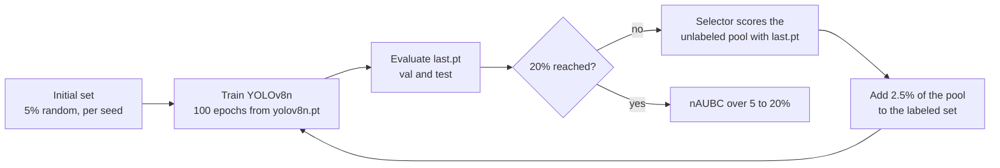

# Active learning for waste detection on SortWaste

Code for a controlled comparison of four active-learning (AL) acquisition
strategies for object detection on SortWaste with YOLOv8n. All strategies share
the dataset split, the initial labeled set of each seed, the detector, the
training schedule and the evaluation settings. Only the acquisition rule
changes.

| Key | Strategy | Source |
|---|---|---|
| `random` | Uniform random sampling | Settles, 2009 |
| `ppal` | PPAL: difficulty-calibrated uncertainty (DCUS), then category-conditioned matching similarity (CCMS) diversity | Yang et al., CVPR 2024 |
| `entropy` | Entropy-ENMS-DivProto: binary entropy with entropy-based NMS (ENMS) and diverse prototypes (DivProto) | Wu et al., CVPR 2022 |
| `rarity_aware` | Rarity-aware composite score with stratified class quotas and a free top-k share | Benhafid and Selouani, Applied Sciences, 2026 |

The three model-based strategies are YOLOv8 adaptations written for this
study, not the authors' code. The [adaptation notes](#adaptation-notes) list
every setting that the source papers leave open.

## Pipeline



## Protocol

| Setting | Value |
|---|---|
| Dataset | SortWaste, official split: 3,705 train (unlabeled pool), 780 val and 776 test images, 8 classes |
| Detector | COCO-pretrained `yolov8n.pt`, Ultralytics 8.4.51 |
| Budgets | 5% initial set, then +2.5% per round up to 20% (185, 278, 370, 463, 556, 648 and 741 images) |
| Seeds | 13, 42, 1337, 2718, 31415 and 65536 (`configs/seeds.yaml`) |
| Training per round | 100 epochs from the same `yolov8n.pt`, batch 64, image size 640, no warm-up, `close_mosaic=0`, no early stopping |
| Checkpoint | `last.pt` of the round, for both evaluation and acquisition |
| Evaluation | `conf=0.001`, `iou=0.7`, FP32, no test-time augmentation, `max_det=300` |
| Primary metric | nAUBC: trapezoidal area under test mAP@50:95 against the number of labeled images, divided by the budget span |

A seed fixes the initial 5% set, the draws of Random and the training seed.
Within a seed all strategies start from the same initial set, so results are
paired by seed. The initial set is drawn uniformly at random. Its class
coverage is checked against the thresholds in `configs/base.yaml`, and a seed
that fails the check stops the run instead of being redrawn.

The protocol is enforced in code. `albench/config.py` rejects configs that
change it, and `albench/al/protocol.py` stops a run if Ultralytics changes the
batch size, epoch count, warm-up or resume setting during training.

## Installation

The runs used Python 3.14 and CUDA GPUs. From the repository root:

```bash
python -m venv .venv
# Windows: .venv\Scripts\activate    Linux/macOS: source .venv/bin/activate
pip install -r requirements.txt
pip install --force-reinstall torch==2.12.0 torchvision==0.27.0 \
    --index-url https://download.pytorch.org/whl/cu130
python -m pytest -q
```

`requirements.lock.txt` is the full package list of the local environment.
Ultralytics downloads `yolov8n.pt` on first use. For the Kaggle archives, place
`yolov8n.pt` in the repository root first.

## Dataset

Download SortWaste (Inácio et al., WACV Workshops 2026) and extract it. The
official package keeps images under `splited_all_dataset/` and YOLO labels under
`splited_all_dataset_yolo/`. Convert it to a standard YOLO tree without
changing the split:

```bash
python scripts/00_prepare_sortwaste.py --source <extracted>/dataset
```

This writes `datasets/export_sortwaste/` with `train/`, `val/`, `test/` and
`data.yaml`. Set `DATA_ROOT` to place it elsewhere.

## Running

```bash
# Full-data reference model
python scripts/05_train_baseline.py --config sortwaste --frac 1.0

# All strategies and seeds (7 training runs per strategy and seed)
python scripts/06_run_al.py --config sortwaste

# One strategy and seed on one GPU
python scripts/06_run_al.py --config sortwaste --strategy ppal --seed 13 --device 0

# nAUBC tables, per-seed values, figures and provenance
python scripts/07_al_report.py --config sortwaste
```

Runs resume by round. Each finished round stores a state file with a
fingerprint of the config, source code, model weights and dataset, and a
resumed run stops if any of them has changed. Several processes, one per GPU,
can write to the same `results.csv`, which is protected by a file lock.

The notebooks in `kaggle/` run the same scripts on Kaggle.
`scripts/08_pack_kaggle.py` builds the code and data archives they expect.

Other scripts:

| Script | Purpose |
|---|---|
| `01_audit_dataset.py`, `04_distribution_charts.py`, `density_stats.py` | Dataset statistics and class distribution charts |
| `09_preflight_l0.py` | Trains one initial set and checks convergence on the validation split only |
| `10_audit_entropy_features.py` | Checks that Entropy features stay aligned with the boxes after NMS |

## Outputs

Paths are under `<kind>/sortwaste/<protocol_id>/`, with `protocol_id` set in
`configs/base.yaml`.

| Path | Content |
|---|---|
| `reports/.../al/results.csv` | One row per strategy, seed and round: labeled-image count, val and test mAP, per-class test AP, per-class labeled box counts, and hashes of the labeled set and the query |
| `splits/.../al_<strategy>_s<seed>_r<round>.txt` | Labeled training images used in that round |
| `reports/.../al/*_acq_*.npz` | Selector diagnostics per round (scores, quotas, Stage-1 and Stage-2 statistics) |
| `reports/.../al/tbl_aubc.*`, `endpoint_by_seed.md`, `PROVENANCE` | nAUBC summary, per-seed values and paired gaps, protocol record |
| `runs/.../al/` | Ultralytics training and evaluation runs |
| `state/.../al/` | Resume state |

In `results.csv`, `labeled_sha` identifies the set used to train the round,
`query_sha` the images selected after it, and `next_labeled_sha` the set for
the next round. All strategies of a seed share `labeled_sha` at round 0. The
hashes are computed from absolute image paths, so they are comparable only
within one machine.

## Adaptation notes

**PPAL.** Class quality is computed from every positive assignment of the
YOLOv8 `TaskAlignedAssigner` during training, through a read-only wrapper that
leaves the loss and gradients unchanged. YOLOv8 has independent sigmoid class
scores, so box uncertainty is the binary entropy of the top class score. CCMS
compares class-score vectors normalized to sum to one, with KL divergence.
Detection caps follow the official code: 200 for uncertainty and 100 for
diversity. An image with no detection scores zero in Stage 1 and is left out
of CCMS, where the distance is undefined. A seeded random fill is used only if
too few images remain.

**Entropy-ENMS-DivProto.** YOLOv8 has no objectness output, so detection
confidence is the score of the predicted class after NMS. The object feature is
the 64-dimensional vector at the Detect-head input, aligned one-to-one with the
kept boxes through Ultralytics' native object-feature path. The paper does not
set a score threshold, NMS IoU or detection cap for YOLOv8, so `score_thr=0.05`,
`nms_iou=0.7` and `max_det=300` are adapter settings. ENMS and DivProto
thresholds follow the paper. Images are taken in score order while
minority-class quotas remain, subject to the intra-class and inter-class
checks. Once the quotas are used up, the remaining slots are filled in score
order.

**Rarity-aware.** Constants follow the paper's severe-imbalance profile
(`gamma=2.0`, `beta=0.6`, `alpha` clipped to [0.8, 2.5], `rho=0.5`). The source
detector, YOLOv10, is NMS-free. For YOLOv8, predictions are kept from
confidence 0.0001 with NMS at IoU 0.7 and up to 300 detections per image, close
to the 300 low-confidence predictions per image in the paper's supplementary
data. Box geometry is computed in letterboxed input coordinates. Stratified
slots that no image can fill move to the free top-k share, so the query always
has the full budget.

No selector reads the labels of unlabeled images. Class counts used by the
DivProto and Rarity-aware quotas come from the labeled set only. The four
background-only training images stay in the pool for every strategy.

## Repository layout

```text
albench/
  config.py            config loading and protocol validation
  evaluation.py        shared evaluation settings
  al/
    loop.py            AL loop for one strategy and seed, results.csv, resume state
    select_*.py        Random, PPAL, Entropy and Rarity-aware selectors
    ppal_*.py, ccms.py PPAL difficulty, features, CCMS and diagnostics
    entropy_*.py       ENMS, DivProto and YOLOv8 object features
    protocol.py        training guards
    metrics.py         nAUBC and paired differences
    charts.py, health.py, ppal_charts.py, tables.py   report figures and tables
  data/                YOLO label scanning and dataset audit
configs/               protocol (base.yaml), dataset and seeds
scripts/               pipeline scripts and diagnostics
kaggle/                Kaggle notebooks
tests/                 unit tests for formulas, selectors and protocol guards
```

## Citation

If you use this code, please cite the accompanying paper, as well as SortWaste
and the source papers of the strategies you use.
